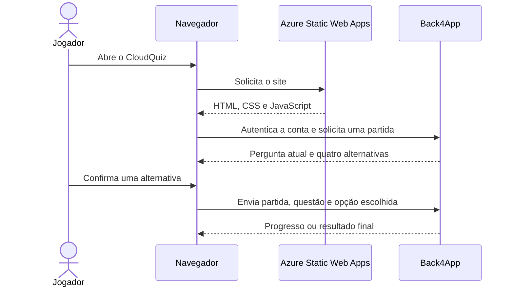

# CloudQuiz

O CloudQuiz é um jogo de perguntas e respostas sobre computação em nuvem, desenvolvido pelo Grupo 1 para a disciplina de Desenvolvimento de Software em Nuvem da Universidade de Fortaleza. Cada rodada tem dez perguntas. Ao jogar com uma conta, o resultado fica salvo e pode ser comparado com o de outras partidas.

**[Jogar no navegador](https://victorious-pond-0a0cb9d10.5.azurestaticapps.net/)** · [Como jogar](https://victorious-pond-0a0cb9d10.5.azurestaticapps.net/como-jogar.html) · [Ver testes no GitHub Actions](https://github.com/vscaueh/CloudQuiz/actions/workflows/ci.yml)

## Primeira partida

1. Na tela inicial, escolha **Criar conta** para salvar seus resultados ou **Experimentar modo treino** para conhecer o jogo sem cadastro. Se você já tem conta, entre com seu **nome de usuário** e senha. O apelido é o nome que aparece no placar.
2. Na **Visão geral**, clique em **Começar partida**. A modalidade com conta sorteia dez questões de um banco inicial de 24, sem repetir perguntas na rodada.
3. Leia a pergunta, escolha uma das quatro alternativas e clique em **Confirmar resposta**. Você pode trocar a opção antes de confirmar. Cada acerto vale 100 pontos e cada erro vale zero. Por exemplo, cinco acertos em dez perguntas rendem **500 de 1.000 pontos**.
4. Ao concluir, abra **Minhas partidas** para consultar seus 20 resultados mais recentes. O **Ranking global** mostra as dez melhores partidas de todos os jogadores. Um jogador pode aparecer mais de uma vez. Em caso de empate, a partida concluída primeiro fica à frente.

O botão **Como jogar** aparece antes do login e na Visão geral. Durante uma rodada, abra a aba **Como jogar** e use **Voltar à pergunta** para continuar de onde parou, inclusive com a alternativa selecionada. O treino tem perguntas próprias e guarda o progresso na memória da página. Ao recarregar ou encerrar o treino, esse progresso é perdido.

## O que acontece quando uma resposta é confirmada?

O **Azure Static Web Apps** entrega os arquivos do jogo ao navegador. A interface, escrita em **HTML, CSS e JavaScript** e compilada pelo **Vite**, mostra a pergunta e envia a alternativa escolhida ao **Back4App**. O SDK Parse cuida da conta e da sessão. As funções de jogo são chamadas por HTTPS.



A função `startMatch` seleciona as perguntas e conserva uma cópia delas para aquela rodada. A cada resposta, `submitAnswer` verifica a sessão, o dono da partida e a ordem das questões. O servidor confere o gabarito, calcula os pontos e, após a décima resposta, registra o resultado. O navegador só exibe a confirmação de salvamento depois da resposta do servidor. [Regras da partida](cloud/service.cjs) · [Integração do navegador com o Back4App](src/api.js)

### Como os dados são organizados

| Classe no Back4App | O que representa |
| --- | --- |
| `_User` | Conta do jogador. O apelido identifica a pessoa no placar. |
| `Question` | Enunciado, alternativas, tema e índice da resposta correta. |
| `Match` | Uma rodada vinculada ao jogador, com as perguntas sorteadas e o estado da partida. |
| `Answer` | A alternativa confirmada para uma questão daquela partida e se houve acerto. |
| `Score` | O resultado da partida concluída, com apelido, pontos e número de acertos. |

As classes do jogo bloqueiam leitura e gravação diretas pelo cliente. A API entrega a pergunta atual sem o gabarito. Dois índices únicos protegem a pontuação contra reenvios: `Answer.dedupeKey` impede que uma questão conte duas vezes na mesma partida e `Score.matchKey` impede dois resultados para a mesma rodada. [Modelo e permissões](scripts/setup-back4app.mjs) · [Consultas de ranking e histórico](cloud/repository.cjs)

## Executar o projeto

**No computador**, use Node.js 22.12 ou superior e npm. Na primeira execução:

```sh
git clone https://github.com/vscaueh/CloudQuiz.git
cd CloudQuiz
npm ci
npm run dev
```

Abra o endereço informado no terminal, normalmente `http://localhost:5173`. O modo treino funciona sem configurar o Back4App. Para usar cadastro, histórico e ranking, copie `.env.example` para `.env` na raiz do projeto e reinicie o Vite. O exemplo já contém a configuração **pública do aplicativo da equipe**. Nesse caso, partidas jogadas localmente com uma conta gravam resultados no mesmo backend usado pelo site publicado.

**No GitHub Codespaces**, [abra um ambiente do projeto](https://codespaces.new/vscaueh/CloudQuiz), aguarde a instalação, execute `npm run dev` no terminal e abra a porta **5173** na aba **Portas**. A prévia depende de o Codespace estar em execução. Para jogar sem iniciar um ambiente de desenvolvimento, use o link do Azure no topo. [Configuração do ambiente](.devcontainer/devcontainer.json)

**Para usar seu próprio backend**, siga o guia para criar as classes, instalar os índices, carregar as perguntas e publicar o Cloud Code. Depois, ajuste `VITE_PARSE_APP_ID`, `VITE_PARSE_JAVASCRIPT_KEY` e `VITE_PARSE_SERVER_URL` no seu `.env`. A Master Key é administrativa e deve ficar fora das variáveis `VITE_`, que são incorporadas ao site. [Configuração do Back4App](docs/BACK4APP.md)

## Testes e publicação

| Comando | Para que serve |
| --- | --- |
| `npm test` | Testa as regras e o serviço do jogo com Vitest. |
| `npm run test:e2e` | Abre o navegador com Playwright e percorre os fluxos da interface. Na primeira execução local, instale o navegador com `npx playwright install chromium`. |
| `npm run build` | Gera a pasta `dist/` com os arquivos de produção. |
| `npm run preview` | Serve localmente o conteúdo de `dist/` para conferir a versão compilada. |

O teste de nuvem entra com uma conta dedicada, recarrega a página para verificar a sessão, conclui uma partida e confere o resultado salvo, o ranking, o histórico e o logout. Para executá-lo, configure o frontend e disponibilize `CLOUDQUIZ_TEST_USERNAME` e `CLOUDQUIZ_TEST_PASSWORD` como variáveis de ambiente do processo de teste. Sem essas credenciais, o Playwright marca esse cenário como **ignorado**. Os testes de treino e tutorial podem rodar sem conta. [Teste com Back4App real](tests/e2e/cloud.spec.js) · [Teste do tutorial e da retomada](tests/e2e/guide.spec.js)

O GitHub Actions instala as dependências, roda os testes e compila a aplicação nos pushes e pull requests para `dev` e `main`. A versão entregue foi publicada no Azure pela CLI do Static Web Apps. O repositório também contém um workflow de publicação opcional. [Configuração dos testes](.github/workflows/ci.yml) · [Guia de publicação no Azure](docs/AZURE-E-GITHUB.md)

## Evidências do trabalho

| O que conferir | Onde encontrar |
| --- | --- |
| Jogo hospedado e guia do jogador | [Produção no Azure](https://victorious-pond-0a0cb9d10.5.azurestaticapps.net/) · [Tutorial publicado](https://victorious-pond-0a0cb9d10.5.azurestaticapps.net/como-jogar.html) |
| Implementação da interface e banco inicial de questões | [Código da interface](src/) · [Questões do projeto](data/questions.json) |
| Validação de sessão, pontuação e isolamento entre jogadores | [Registro de 11 verificações no Back4App](docs/remote-verification.json) · [Execução do workflow com o backend real](https://github.com/vscaueh/CloudQuiz/actions/runs/43057529563) |
| Integração das mudanças por branches | [Jogo integrado em dev](https://github.com/vscaueh/CloudQuiz/pull/1) · [Primeira versão em main](https://github.com/vscaueh/CloudQuiz/pull/2) · [Tutorial na navegação](https://github.com/vscaueh/CloudQuiz/pull/7) |
| Organização das tarefas | [Quadro da equipe no Trello](https://trello.com/b/93mpbMal/cloudquiz-grupo-1-software-em-nuvem) (acesso restrito). A captura do quadro está no relatório da reentrega. |

## Equipe

| Integrante | Matrícula | Papel previsto no plano de trabalho |
| --- | --- | --- |
| Caueh Bento de Lima Mota | 26120706 | Frontend |
| Vinicius Ferreira dos Santos Correia | 2522711 | Backend |
| João Lucas Ferreira | 2612740 | Banco de dados e testes |
| Matheus Lucas Oliveira | 2612700 | Gestão do projeto e DevOps |
